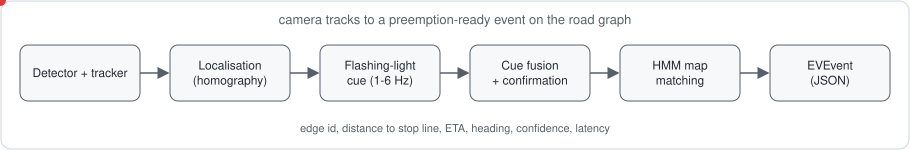
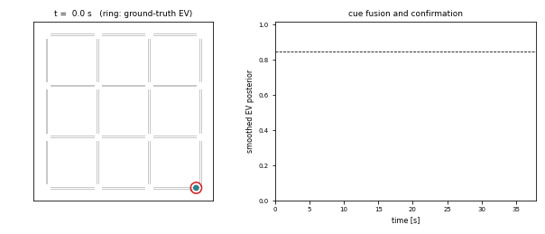
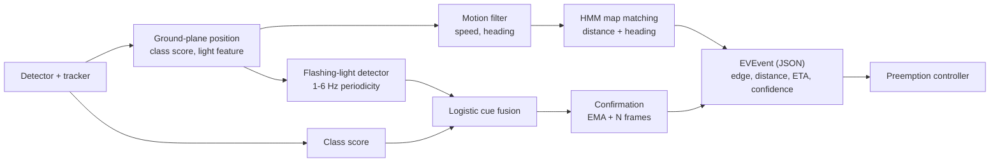
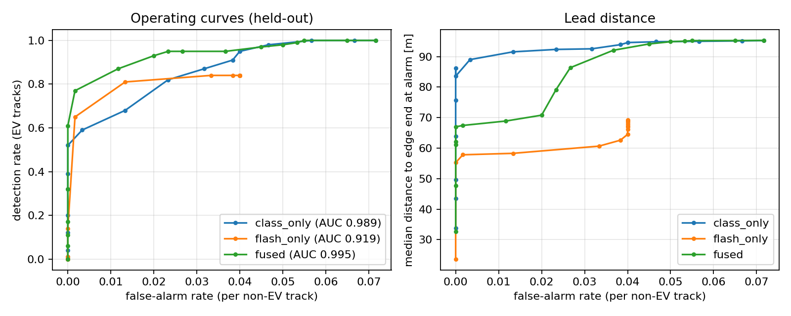

# ev-perception-for-preemption

**From camera tracks to a preemption-ready event: flashing-light cue, map matching, heading and an explicit event contract for emergency-vehicle signal preemption.**

A signal controller cannot use "an ambulance bounding box". It needs to know *which road-graph
edge* the vehicle is on, *how far* it is from the stop line, *how fast and in which direction*
it moves, *how confident* the system is, and it needs this with low latency and few false
preemptions. This package is the layer that produces exactly that from the output of any
detector + tracker (e.g. YOLO + ByteTrack). No detector is trained here.

[](https://github.com/soheylfalahzade/ev-perception-for-preemption/actions)


<p align="center"></p>

<p align="center"></p>

<sub>Animation: one emulated scenario processed by the pipeline. Left: observed track positions coloured by the smoothed emergency posterior; red ring = ground-truth emergency vehicle (display only). Right: posterior per track against the confirmation threshold; stars mark emitted events on the matched edge. The gray track that approaches the threshold is a *confuser*. Regenerate with `evperc-gif`.</sub>



## Components

| module | role |
|---|---|
| `flash.py` | `light_feature` (saturated red/blue fraction on the roof region) and `FlashDetector`: resamples a per-track series, windows it, scores in-band spectral peak concentration and modulation depth |
| `motion.py` | 2-D constant-velocity Kalman filter; heading undefined below 1.5 m/s |
| `mapmatch.py` | `RoadGraph` (polylines, SUMO `.net.xml` loader) and online HMM matcher with distance and heading emission, successor-aware transitions |
| `fusion.py` | logistic fusion of detector and flashing-light evidence, fitted with IRLS; EMA + consecutive-frame confirmation |
| `pipeline.py` | `EVPipeline.process(t, observations) -> list[EVEvent]` with per-stage latency profiling |
| `events.py` | `EVEvent` and the JSON schema ([`configs/event_schema.json`](configs/event_schema.json)) |
| `adapters.py` | converts detector boxes + frame into observations (crop light feature, homography to ground) |
| `synth.py` | perception-level emulator with exact ground truth |
| `evaluate.py` | cue ablation, operating points, lead distance, map matching, latency |
| `sumo_preemption.py` | closed-loop preemption study in SUMO |

## Interface to the control layer

One JSON line per confirmed (track, edge) pair:

```json
{"timestamp_s": 6.88, "track_id": 1, "edge_id": "20>30", "s_m": 28.6, "dist_to_stop_line_m": 71.4,
 "eta_s": 5.05, "heading_deg": 2.0, "speed_mps": 14.1, "confidence": 0.94, "match_prob": 1.0,
 "latency_ms": 1.2, "schema_version": "1.0"}
```

`dist_to_stop_line_m` is the distance to the end of the matched edge, which is taken to be the stop
line / junction entry. A controller can preempt when `eta_s` falls below its clearance time and
`confidence` is above its own operating point.

## Installation (Ubuntu / WSL2)

```bash
python3 -m venv .venv && source .venv/bin/activate
pip install -e ".[dev]"
pip install -e ".[sumo]"      # optional, for the closed-loop study
pytest
```

## Usage

```bash
evperc-eval --dev 40 --test 100 --out results/eval         # ~25 min on one core
evperc-sumo --seeds 12 --jobs 2 --out results/sumo         # needs the sumo extra
```

```python
from evperc import EVPipeline, RoadGraph, ConfirmConfig
graph = RoadGraph.from_sumo_net("examples/sumo/demo.net.xml")
pipe = EVPipeline(graph, confirm=ConfirmConfig(threshold=0.85, confirm_frames=5))
for t, observations in stream:                 # list[TrackObservation] per frame
    for event in pipe.process(t, observations):
        publish(event.to_json())
```

## Evaluation protocol

**Perception emulation.** A 4 x 4 street grid (48 directed edges) with cameras at every node
(90 m radius). Each scenario contains one emergency vehicle and six ordinary vehicles on random
routes. Observations follow explicit assumptions: position noise `0.8 + 0.04 * range` m, detection
probability falling with range, detector scores drawn from Beta distributions with a per-track mean
(emergency 0.55-0.9, ordinary 0.02-0.2, 8% *confusers* 0.4-0.7), light feature with a 2-4 Hz square
wave for 85% of emergency vehicles (steady for the rest), and ordinary vehicles that are steady,
slowly fluctuating (10%) or hazard-blinking at 1.2-1.8 Hz (40% of confusers). These distributions are
assumptions, not measurements.

**Protocol.** Fusion models are fitted and the operating threshold is chosen on 40 development
scenarios (seeds 1000+), the threshold being the smallest one with a development false-alarm rate
of at most 1% per ordinary track. Reported numbers use 100 disjoint scenarios (seeds 0-99: 100
emergency tracks, 600 ordinary tracks). Alarm = smoothed posterior at or above the threshold for 5
consecutive frames.

## Results (emulated perception)

| cues | detection rate [95% CI] | false alarms per ordinary track [95% CI] | median distance to edge end at alarm | track AUC |
|---|---|---|---|---|
| detector only | 0.68 [0.58, 0.76] | 0.0133 [0.0068, 0.0261] | 91.6 m | 0.989 |
| flashing light only | 0.65 [0.55, 0.74] | 0.0017 [0.0003, 0.0094] | 57.8 m | 0.919 |
| **fused** | **0.77** [0.68, 0.84] | **0.0017** [0.0003, 0.0094] | 67.4 m | **0.995** |

Intervals are Wilson 95% intervals on 100 emergency and 600 ordinary tracks
([`docs/results/intervals.json`](docs/results/intervals.json)).



- Point estimates favour the fused model on both axes, but the intervals overlap (detection
  0.77 vs 0.68; false alarms 0.0017 vs 0.0133): with 100 emergency tracks this study does not
  establish a significant difference. The track-level AUC (0.995 vs 0.989) points the same way.
- The flashing-light cue needs about 1.5 s of history, so fused alarms come later (67 m median
  lead) than detector-only alarms (92 m). The price of fewer false alarms is lead distance.
- False-alarm rates rest on 1 (fused) and 8 (detector only) false alarms among 600 ordinary tracks.

**Map matching and heading** (439k frame-level comparisons, frames on junction connectors excluded):

| method | edge accuracy |
|---|---|
| nearest edge (geometric baseline) | 0.900 |
| HMM with heading (this package) | 0.974 |

Median heading error at speeds of at least 3 m/s: 1.6 degrees.

**Latency** (single CPU core, pure Python, about 7 simultaneous tracks): per-frame total p50 1.1 ms,
p95 1.9 ms, p99 2.6 ms; p95 per stage: map matching 1.39, flash 0.35, motion 0.17, fusion 0.02 ms.
This excludes detection and tracking, which dominate in practice.

## Closed-loop preemption in SUMO

An emergency vehicle is inserted into a two-lane approach (200 m) with a fixed-time light (30 s
green, 27 s red) and queued traffic (1150 veh/h, 22% trucks). The light is forced green when the
perception model confirms the vehicle (detection range, 0.5 s latency, miss probability, false
event rate). 12 seeds; each seed replays identical traffic in every condition (paired). Time is
measured from insertion until the vehicle leaves the approach (240 m).

| condition | EV passage time (s) | change vs. none [95% CI] |
|---|---|---|
| no preemption | 34.4 | |
| preempt from 30 m | 21.6 | -12.8 [-20.4, -5.6] |
| preempt from 60 m | 20.4 | -14.1 [-21.7, -6.9] |
| preempt from 90 m | 20.1 | -14.3 [-22.0, -7.0] |
| preempt from 120 m | 19.9 | -14.5 [-22.3, -7.0] |
| preempt from 150 m | 19.3 | -15.1 [-22.4, -8.0] |
| 90 m, 8% misses, 6 false events/h | 20.1 | -14.4 [-22.0, -6.8] |

In this scenario preemption removes about 14 s of delay, and the benefit is almost insensitive to the
detection range between 30 and 150 m (confidence intervals overlap): one queued approach does not
reward earlier detection. Whether longer lead matters in denser networks or for corridor-wide green
waves is not tested here. Perception enters this study only through four parameters; the link to
`evperc-eval` is that the lead distances it measures are the values to use. False preemptions are
reported as events and forced-green seconds only, since the example network has no cross traffic to
measure their cost.

## Claims and evidence

| claim | evidence | file |
|---|---|---|
| HMM map matching with heading beats nearest-edge matching | 0.974 vs 0.900 edge accuracy, 439k frame comparisons | `docs/results/results.json` |
| the pipeline is fast enough for per-frame use | p95 1.9 ms per frame on one core (excludes detection and tracking) | `docs/results/results.json` |
| fusing cues is at least as good as either cue alone | point estimates favour fusion; intervals overlap | `docs/results/intervals.json` |
| preemption shortens emergency-vehicle passage in the studied scenario | 34.4 s to about 20 s, paired, 12 seeds, CI excludes zero | `docs/results/sumo_summary.json` |
| earlier detection yields more benefit | **not supported**: effect is flat from 30 to 150 m in this scenario | `docs/results/sumo_summary.json` |

## Limitations and scope

- Perception is **emulated**. No real footage, no real sirens, no camera images are processed in the
  reported experiments. The adapter and `light_feature` are unit-tested on synthetic pixels only.
- The flashing-light cue assumes frame rates of roughly 15 fps or more and visible light bars; LED
  flicker and rolling-shutter aliasing are not modelled.
- Hazard lights are modelled as a confounder; amber beacons of other utility vehicles and reflective
  signage are not.
- Camera handover is idealised (track IDs persist across cameras).
- The closed-loop study uses one approach and one signal; false-preemption cost is a proxy.
- A CARLA integration is not included.

## Threats to validity

- *Construct*: perception outputs are emulated from stated distributions; real detectors, sirens
  and cameras may violate them (correlated misses, rolling-shutter aliasing, glare).
- *Internal*: operating thresholds and fusion weights are fitted on development seeds and applied
  to disjoint test seeds; hazard-light confusers are the only modelled hard negatives.
- *External*: one grid topology, one signal program and one approach in the closed-loop study.
- *Statistical*: 100 emergency tracks give wide intervals; closed-loop intervals use 12 seeds.

## Data and code availability

All code, configuration, seeds and result files used for the figures and tables are in this
repository. No external datasets are used. See [`docs/METHODS.md`](docs/METHODS.md) for the formal
definitions and [`docs/REPRODUCIBILITY.md`](docs/REPRODUCIBILITY.md) for exact commands.

## Citation

See [`CITATION.cff`](CITATION.cff).

## Roadmap

Labelled real footage and a fine-tuned emergency-vehicle detector; CARLA co-simulation with rendered
sirens; multi-intersection corridor preemption; cost model for false preemptions with cross traffic.

## License

MIT. See [LICENSE](LICENSE).
